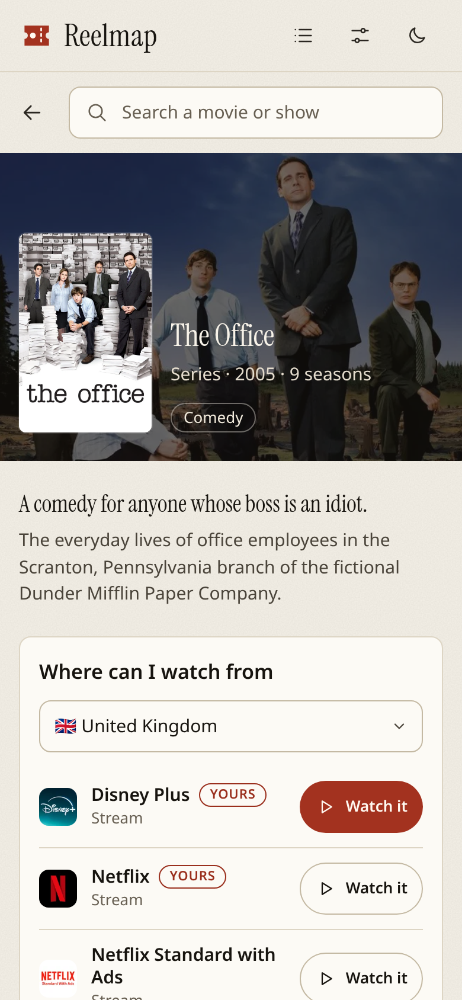
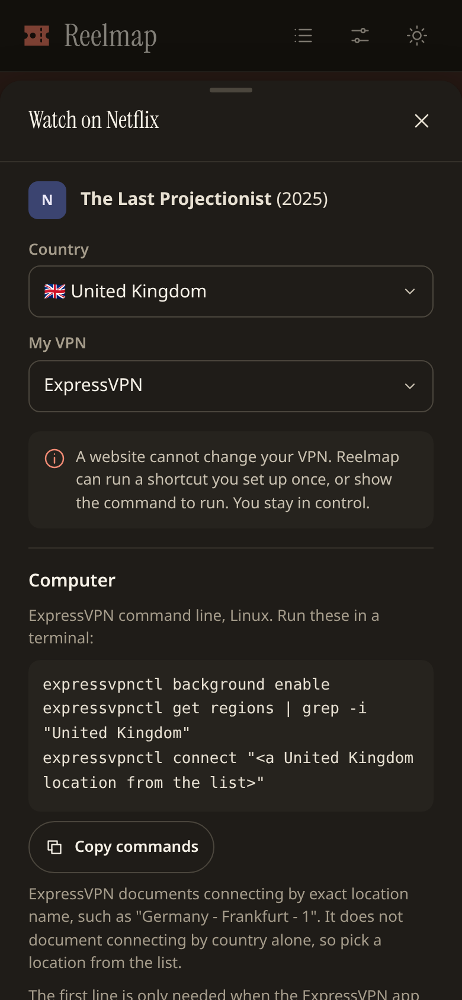
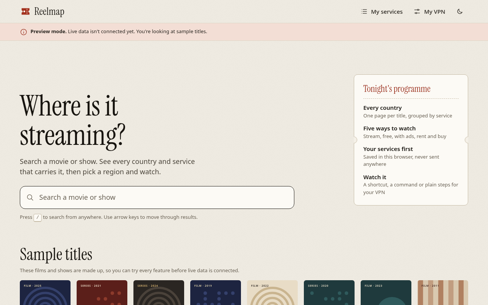
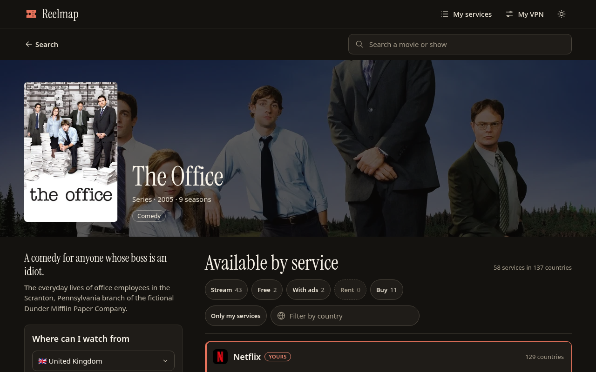
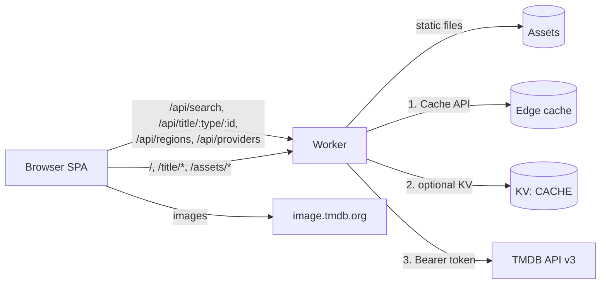

# Reelmap

Search any movie or show and see which countries and streaming services carry it. Pick a region, switch your VPN, and watch.

**Live:** https://watch.hatethespurs.com

| Phone, light | Phone, dark |
|---|---|
|  |  |

| Desktop, light | Desktop, dark |
|---|---|
|  |  |

All screenshots are in [docs/screenshots](docs/screenshots). They were taken on the live site with real TMDB data.

## Features

- **Instant search.** Debounced (200 ms) as you type, stale requests aborted, posters, year and type in the list. Full keyboard support: `/` focuses search, arrow keys move, Enter opens, Escape closes. Built on the ARIA combobox pattern.
- **Availability by service.** Each service lists the countries that carry the title as flag and code chips, split into stream, free, with ads, rent and buy. Services are sorted by country count, with your services first.
- **Filters.** Multi-select type chips with live counts, "Only my services", and a country filter that matches codes or names.
- **Where can I watch from a country.** Pick a country to see every service that has the title there, with the TMDB watch link as "More options".
- **My services.** Searchable provider picker. Saved in localStorage, highlighted and sorted first.
- **My VPN.** Saved in localStorage, ExpressVPN by default. Watch it tailors its steps to it.
- **Watch it.** One sheet per service and country: a Shortcuts link, the official CLI command with a copy button, plain manual steps, and a link to the service. See [Watch it](#watch-it).
- **Preview mode.** With no TMDB token the API returns `503 {"error":"not_configured"}` and the app says so plainly, then serves fictional sample titles with generated typographic posters. Every feature works in preview.
- **Themes.** Light and dark follow the system, with a toggle that persists. AA contrast, visible focus rings, 44 px targets, reduced motion respected.
- **Small.** Vanilla TypeScript and esbuild, no framework. About 45 kB of JS and 24 kB of CSS before compression, plus one 21 kB display face.

## Stack

- Cloudflare Worker (TypeScript) serving static assets and a validated TMDB proxy under `/api/*`
- Client: vanilla TypeScript, bundled with esbuild, code-split preview data
- Tests: Vitest for logic and the Worker, Playwright for end-to-end flows at 390 and 1280 px

## Architecture



- The Worker validates input (query 1 to 100 characters, positive integer ids, `movie` or `tv`), allows only GET, HEAD and OPTIONS, and returns 400 JSON for anything else.
- It adds `Authorization: Bearer <token>` upstream. The token lives only in the Worker secret and never reaches the client, a response or a cache key.
- Responses are normalized to small JSON shapes, then cached: search 10 minutes, regions and provider lists 7 days. Title details are 24 hours and watch providers 12 hours; because the title response carries both, it uses 12 hours. A KV namespace bound as `CACHE` adds a second layer when present.
- Every response gets a strict CSP (`self` plus `image.tmdb.org` for images, no inline scripts or styles), `nosniff`, `strict-origin-when-cross-origin`, a minimal Permissions-Policy, `frame-ancestors 'none'` and HSTS. The API is same-origin; OPTIONS answers without a wildcard origin.
- Hashed assets are cached for a year as immutable; HTML is `no-cache`. `/title/movie/123` style paths get the SPA shell.

## Run it

```sh
npm install
npm run build          # client into dist/public
npm run serve          # Worker in Node on http://localhost:8787, preview mode
MOCK_TMDB=1 npm run serve   # live mode against a mocked TMDB built from fixtures
npm run dev            # build, then wrangler dev
```

Live data needs a TMDB v4 Read Access Token (it works for all v3 endpoints). Store it as a Worker secret:

```sh
npx wrangler secret put TMDB_READ_ACCESS_TOKEN
```

For `wrangler dev`, put it in `.dev.vars` (git-ignored) as `TMDB_READ_ACCESS_TOKEN=...`.

### Deploy layouts

- `wrangler.toml` deploys the Worker `reelmap` with the `dist/public` assets directory on the custom domain `watch.hatethespurs.com`.
- `npm run build:embedded` writes `dist-embedded/worker.js`: one ES module with every static file inlined as base64 plus a content-type map. Upload it through the Cloudflare API as a single module, no assets upload step.

## Tests

```sh
npm test            # Vitest: grouping, filters, validation, Watch it builders, Worker proxy
npm run e2e         # Playwright, Chromium at 390x844 and 1280x800
BASE_URL=https://watch.hatethespurs.com npm run e2e   # same suite against a live site
PREVIEW=1 BASE_URL=https://watch.hatethespurs.com npm run e2e   # live site still in preview mode (no token)
npm run typecheck
npm run lint
npm run screenshots # regenerate docs/screenshots from local preview mode
```

The e2e run starts two local servers: one in preview mode and one in live mode against a mocked TMDB. Every test fails on any console error or warning.

## Watch it

A website cannot connect or switch a VPN, and Reelmap says so in the sheet. What it does:

1. **iPhone, iPad or Mac.** You build one shortcut called "Reelmap Watch" once, following the numbered recipe in the sheet. The Run button opens `shortcuts://run-shortcut?name=Reelmap%20Watch&input=text&text=<CC>|<url>`. The shortcut splits the input, switches the VPN (Proton VPN's "Connect to region" action takes a country; for the others it uses Apple's Set VPN with per-country configurations you installed, or asks you to pick the country), waits, and opens the link. Reelmap does not ship a `.shortcut` file, because Apple only signs them with `shortcuts sign` on macOS.
2. **Computer.** The official CLI command for your VPN and the country, with a copy button: `expressvpnctl` (Linux), `nordvpn` (Linux), `protonvpn connect --country` (Linux), `mullvad relay set location` (Linux, macOS, Windows). Surfshark and Norton VPN document no scriptable country option, so the sheet says so.
3. **Step by step.** Plain manual steps for any VPN, always including "Fully close and reopen the streaming app so it re-detects your region."
4. **Open the service.** TMDB gives no per-service title ids, so the link opens the service's own search for the title, or the TMDB watch page when there is no known search URL. The label says which.

Every VPN claim, with its official source and the date checked, is in [docs/vpn-support.md](docs/vpn-support.md). No affiliate links, and no promises about any service's terms.

## Attribution

<a href="https://www.themoviedb.org"></a>

This product uses the TMDB API but is not endorsed or certified by TMDB.

Streaming availability data is provided by [JustWatch](https://www.justwatch.com).

The display face is Instrument Serif, under the SIL Open Font License (see `public/fonts/OFL-instrument-serif.txt`).

## License

[MIT](LICENSE) © 2026 Nishant Kumar
